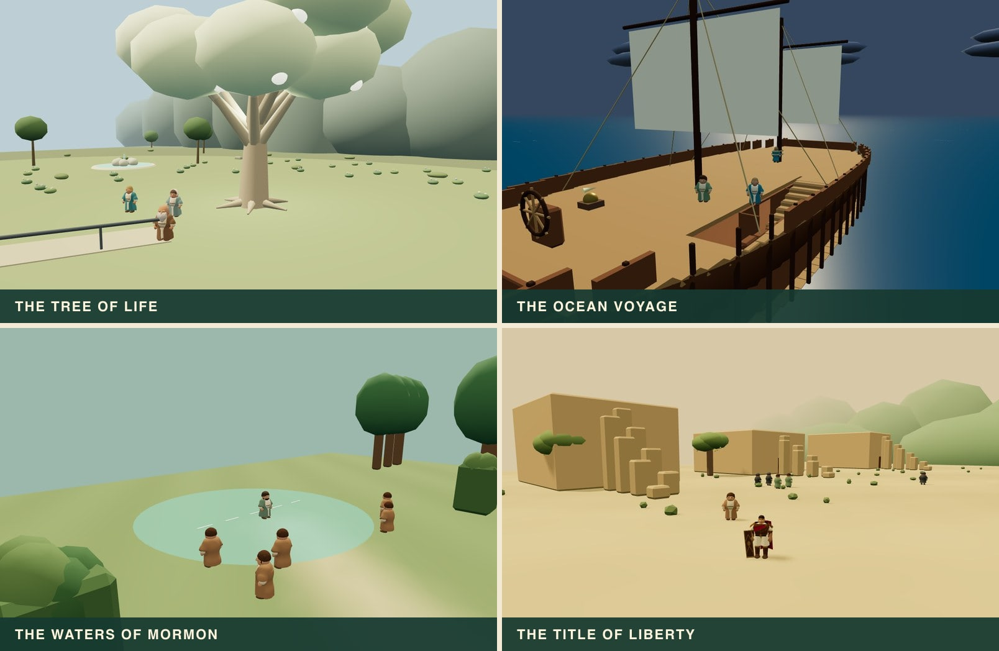

# Super Mormon

**Step into the stories. Find your own adventure.**

Explore Jerusalem, follow the iron rod, build a ship, and discover 32 Book of Mormon adventures in a free, open-source browser game. Run, jump, climb, and explore on a computer, phone, or controller.

[**Play the game →**](https://cgood92.github.io/super-mormon/) · [**Instruction booklet →**](https://cgood92.github.io/super-mormon/manual.html)

_Posed scenes rendered with the game’s own characters and scenery._

Made for families who enjoy scripture-inspired exploration, including Latter-day Saint (LDS) families looking for a Sunday video game. The instruction booklet covers controls, movement, all 32 adventures, and scripture references.

An independent game in development, not affiliated with or endorsed by The Church of Jesus Christ of Latter-day Saints, shared under the [MIT License](LICENSE). Stories, places, and characters include artistic adaptations.

## Feedback & contributions

Found a bug or have an idea? [Open an issue](https://github.com/cgood92/super-mormon/issues/new). [Pull requests](https://github.com/cgood92/super-mormon/compare) are very welcome!

## Developers

[If you’re a developer, click here.](CONTRIBUTING.md)
